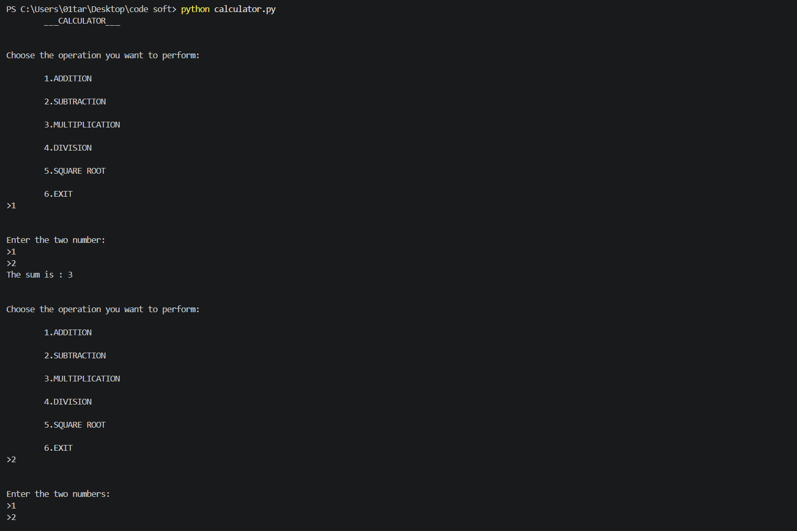

# CodeSoft Python Internship Projects

Welcome to my CodeSoft Python Internship Projects repository! This repository contains three Python projects developed to practice programming fundamentals, problem-solving, GUI development, and file handling.

---

## Task 1: To-Do List Application

### Description
A task management application built using Python and Tkinter to help users organize their daily tasks.

### Features
- Add, update, and delete tasks.
- Mark tasks as completed or undo completion.
- Clear all tasks.
- Save and load tasks using JSON.
- Display total and completed task counts.

### Technologies Used
- Python
- Tkinter
- JSON

### How to Run
```bash
python todo_list.py
```

### Screenshot


**Source Code:** [todo_list.py](todo_list.py)

---

## Task 2: Simple Calculator

### Description
A console-based calculator developed using Python to perform arithmetic operations.

### Features
- Addition, subtraction, multiplication, and division.
- Remainder and power operations.
- Handle invalid number input.
- Prevent division by zero.
- Perform multiple calculations.

### Technologies Used
- Python

### How to Run
```bash
python calculator.py
```

### Screenshot


**Source Code:** [calculator.py](calculator.py)

---

## Task 3: Contact Book Application

### Description
A contact management application built using Python and Tkinter. It allows users to store and manage contact information through a graphical interface.

### Features
- Add contacts with name, phone number, email, and address.
- View a list of contacts by name and phone number.
- Search contacts by name or phone number.
- Select contacts to view their details.
- Update contact information.
- Delete contacts with confirmation.
- Save and load contacts automatically using JSON.

### Technologies Used
- Python
- Tkinter
- JSON

### How to Run
```bash
python contact_book.py
```

### Screenshot


**Source Code:** [contact_book.py](contact_book.py)

---

## About This Repository

These projects were developed as part of my CodeSoft Python Internship. Through these tasks, I practiced Python fundamentals, loops, functions, conditional statements, graphical interfaces, and JSON file handling.

Thank you for visiting my repository!